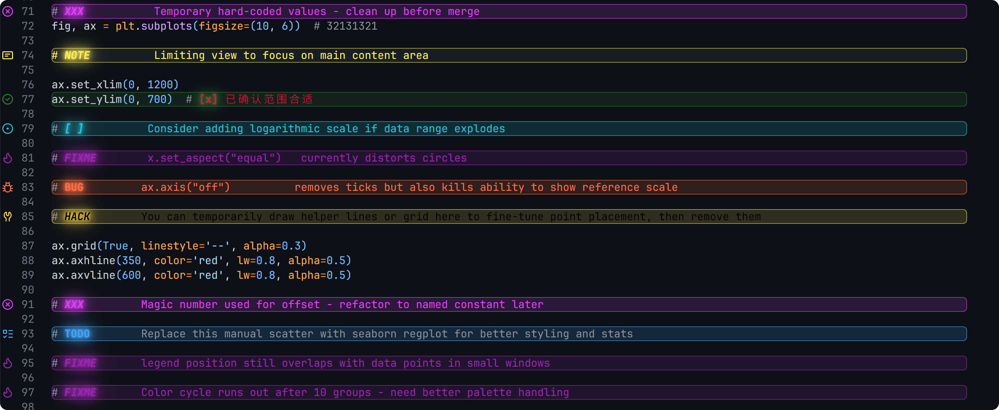

<p align="center">
  <strong>TaskVision — 源码驱动的人机协作知识工作台</strong>
</p>

<p align="center">
  <kbd>&nbsp; 中文 &nbsp;</kbd>&ensp;|&ensp;<a href="README.md"><kbd>&nbsp; English &nbsp;</kbd></a>
</p>

<p align="center">
  <a href="#"></a>&nbsp;
  <a href="#"></a>&nbsp;
  <a href="#"></a>&nbsp;
  <a href="#"></a>&nbsp;
  <a href="#"></a>
</p>

<br/>

<p align="center">
  <strong>把代码注释升级成真正的任务面板，并为 AI 编程工具导出稳定上下文。</strong>
</p>

<br/>

TaskVision 会把代码中的 TODO 类注释转成 VS Code 里的任务树。它保留了传统能力——高亮标签、树视图集中展示、快速跳转回源码——同时新增了内联状态、优先级与备注元数据、AI 上下文导出、状态变化报告，以及基于状态的筛选。

```bash
code --install-extension /path/to/taskvision-3.8.2-preview.vsix
```



> [!IMPORTANT]
> TaskVision 2.0 使用**四通道高亮模型**。样式范围现在拆分为 `colorType`、`glowType`、`glassType`、`fontType`。

## VS Code 原生使用：3 分钟上手（3.8.2 Preview）

在 VS Code 扩展页的右上角 **… → 从 VSIX 安装**，选择本地预览包；也可以使用上面的命令并替换为真实 VSIX 路径。**3.8.2 是本地预览版，尚未发布到 Marketplace。** 安装后先打开自己的代码项目。

1. **读源码与任务**：在代码里写 `// INTENT: 为什么这样设计` 或 `// TODO [todo] 实现校验`。点击活动栏的 **TaskVision** 图标，侧栏「任务与知识」展示标签、任务与源码定位。原生任务树不需要 Node.js 22。
2. **使用工作台**：点击侧栏顶部 **快捷操作 → 新手入门（三步上手）**；选择「打开项目知识工作台」，浏览源码关系、人工指导与审阅。可选 Web/MCP 工作台要求 Node.js **22.18+**；PATH 已有可用 Node 时保留默认设置。
3. **连接编程 Agent**：在快捷操作中选择「复制 Agent MCP 配置」，把复制内容加入所用 Agent 客户端的 MCP 配置。复制动作不会自动连接或修改其他客户端。

**常用设置**：快捷操作中的「更改标签高亮方案」直接选择霓虹／玻璃预设；「高亮通道设置」和「任务树与徽标设置」打开对应 VS Code 原生设置。高级 JSON 参数只有需要微调时再改。菜单与设置说明按 VS Code 显示语言切换中英文；`CORE`、`REUSE`、`INTENT`、`REVIEW` 等源码标签保留英文，方便与 Agent 共享。

---


## 3.8 预览：恢复原版霓虹与玻璃高亮，单击节点展示完整详情

本版直接对齐原 GitHub README 的源码截图：黑色代码画布、按标签颜色发光、低透明度的整行玻璃描边。原来的四通道高亮机制继续生效。CORE、REUSE、INTENT、REVIEW 的默认颜色分别是蓝、绿、紫、黄；默认开启 neon+glass，标签范围辉光 56%，整行玻璃填充 9%、边缘描边 34%。只改变内置缺省值，不覆盖用户已有的自定义方案。

**网页中单击模块/文件节点**会在节点旁打开独立、可滚动的详情卡片，显示实际职责、路径、文件和代码行数、引用/依赖、知识标签、源码注释与来源及相关操作；固定侧栏不会自动挤压画布。点击空白或按 Escape 关闭，双击进入模块，打开完整检查器是独立的显式操作。详情卡采用与原版对应的霓虹标签、细玻璃描边和深色半透明背景，并保留内容可读性。

新注册工程默认深色霓虹，已经保存的浅色/跟随系统个人偏好仍会生效。侧栏标题仅保留打开工作台、刷新和 Quick Actions 三个主要入口，更多原生任务/标签/外观/AI/MCP 操作统一在分组快捷菜单和右键菜单中；命令可以搜索，设置可以直接打开 VS Code Settings。知识标签不再被误标为隐式 [idea]，真正声明的任务状态仍照常显示。

注意：Web 使用 CSS 再现原版视觉语言，VS Code 仍使用原生四通道装饰机制；不能声称二者对任意用户主题和字体逐像素一致。大图线条仍可能交叉。默认深色只用于未保存过偏好的新工程。

详见工作台指南 workspace/README.md 及验收要求 agent/click-detail-vscode-acceptance.md。

## 3.7 预览：多项目切换、个人布局与明暗主题

网页标题旁可选择已登记的工程，也可输入绝对路径并确认添加本地 Git 项目。不同浏览器标签页独立观察不同工程，索引、INTENT、Review 和源码读取都按工程隔离。已登记的工程及个人偏好保存在本机用户私有目录（通常为 ~/.config/taskvision），不进入 Git 或 Agent 知识索引。

新增浅色／深色／跟随系统主题、可拖拽与收起的左侧导航、左／右／下方可停靠的源码详情，鼠标／键盘调整分隔线尺寸。项目图节点位置、缩放视角按工程和结构范围持久保存，支持恢复默认布局。

源码面板使用延迟加载的 Shiki/TextMate 语法规则，结合 VS Code 插件 package.json 中真实 CORE／REUSE／INTENT／REVIEW／TODO 等高亮通道。由 VS Code 扩展打开的初始工程还可只读继承有效的用户高亮配置；独立 Web 或其他登记工程回退默认样式。规则尽量对齐，但浏览器和 VS Code 编辑器的字体、ThemeColor 不保证像素级完全一致。

项目切换后，**JSON 导出也严格跟随当前工程**，不会误导出启动时的默认项目。浅色模式会压暗原本适合深色 VS Code 的浅亮标签正文，保证至少 4.5:1 对比度；深色标签颜色保持不变。分隔线支持方向键与 Shift 加速，也可恢复默认布局。

边界：支持详情面板左／右／底部停靠，尚未支持所有 Toolbar 和面板随意浮动；项目登记必须明确授权本地目录。Web 的 TextMate 与 VS Code 完整编辑器、ThemeColor、字体渲染不能保证逐像素一致。VS Code 用户样式在启动本地工作台服务时读取，其他附加工程回退 manifest 默认规则。

详见 [工作台指南](workspace/README.md) 及 [3.7 验收](agent/personal-workspace-acceptance.md)。

## 3.6 预览：Graph Studio

界面统一为石墨深色；节点直接展示真实职责、全部非零知识标签、文件与代码规模、当前可见引用方／依赖方数量、实际待验收与 Agent 认领。REVIEW 源码阅读点和待验收提交明确区分，不生成虚假健康或完成状态。

线路按端口附近的实际走向排序，平滑曲线、圆角走线、直连三种外观可切换；端口测量与 ELK 路径保持一致，小箭头不再堆叠。新增图例解释颜色、虚实线、依赖方向与节点标签。直连模式明确不避障。默认阅读视图保留85%字号，需要浏览全项目时点击适合画布；缩略图按需开启，避免遮住节点信息。

继续复用现有图引擎与业务核心，无新增运行时依赖。验收依据见 [Graph Studio用户流程](agent/graph-studio-acceptance.md)。

## 3.5 预览：ComfyUI 风格分线与真实关系追踪

架构图为每条可见依赖单独分配稳定的节点端口，ELK 与 React Flow 共用坐标。无遮挡时绘制平滑贝塞尔线；绕过其他模块时通过稳定途经点交给现有 Smart Edge A*。概览按引用方着色，分类视图按真实关系类别着色。悬停或聚焦某条线后其他线及节点淡出，点击仍能阅读原始源码与行号。

多个连接交叉处使用柔和背景间隔，闲置时隐藏多余标签。高扇入模块超出卡片空间时显示拥挤提示，可用聚焦邻居与关系筛选深入查看。依赖箭头始终是引用方指向被引用方，不代表运行时数据流或函数调用。

## 3.4 预览：直接采用官方节点组件

架构图现在实际使用 **React Flow UI 官方 BaseNode 与 NodeTooltip 源码**，保留原始注册表、哈希和 MIT 许可。概览节点精简内容，默认收起右侧详情释放画布，节点间距增大；缩放低于68%时切换为结构阅读，不再挤满微小文字。详情和操作保持屏幕字号，Floating UI 自动避让边界，键盘关闭后回到原节点。原有源码关系、依赖影响、指导编辑和 Review 保留。

源码引入与本地适配见 [开源组件记录](third_party/react-flow-ui/README.md)。这次直接集成官方组件；图引擎、业务知识模型与其他页面继续沿用现有实现。

## 3.3 预览：新版架构节点（React Flow UI）

针对原先节点标题与摘要拥挤、模块和文件辨识度弱的问题，使用 **React Flow UI 官方 Base Node** 的 Header／Content／Footer 组合方式，在现有 React + 原生 CSS 中重建模块卡片和文件卡片。参考 LikeC4 的软件架构分层阅读方式；保留源码可追溯关系、实时 Agent/Review 标记、点击源码、展开模块和智能避障连接。未引入一整套新的 Tailwind/shadcn，也没有切换图形渲染器。详见 [节点设计验收标准](agent/node-design-acceptance.md)。

真实 TaskVision 工程的 8 个顶层模块已用统一布局测量，桌面可完整显示且左下角缩略图不会遮挡节点；较小窗口优先保持架构全貌，必要时降低自动缩放比例，可用滚轮／画布工具放大阅读。

## 3.2 预览：语义关系图、依赖影响与人机协作工作台

**3.2.1 补丁：** 修复 Web 人工 Review 页面读取早期2.1交付时的403与误导性 Diff；历史基线缺失或受当前忽略规则限制的记录会提示重新提交，正常 Review 仍可查真实修改。详见 [工作台指南](workspace/README.md)。

项目已统一为 **严格 TypeScript**：保留旧插件行为，抽离共享领域核心、HTTP/MCP/CLI 适配层，并用 **React、React Flow、ELK 和 Smart Edge** 重做交互式项目地图。

源码中的 CORE／REUSE／INTENT／REVIEW 标签、人类网页指导、Agent 任务认领和实际代码 Review 共用一份模型。页面支持架构概览与深入、源码／知识联动、带冲突保护的编辑、提议采纳、真实差异审阅和知识导入预检。Agent 通过11个MCP工具与专属Skill按需读取、复用和交接。

```sh
npm ci
npm run typecheck
npm run build
npm run workspace:start
```

VS Code 安装预览VSIX后执行 **TaskVision: 打开项目知识工作台**；外部运行环境需要 **Node.js 22.18+**。原有自定义标签保持不变，可执行 **启用知识标签** 追加新标签。`npm run package:preview` 生成本地安装包，不会发布Marketplace。

详细操作、数据存储与权限边界见 [工作台指南](workspace/README.md)，Agent 工作流见 [专属 Skill](workspace/skills/taskvision-workspace/SKILL.md)，验收标准见 [用户流程验收](agent/refactor-acceptance.md)。代码结构：`src/` 是编辑器适配；`packages/shared` 是类型与协议校验；`packages/core` 是知识、索引和协作；`apps/` 是Web、服务、MCP与CLI。

本地优先，无自动云同步、Agent调度或自动合并。租约属于协作约定，人工验收仍由用户负责；结构图不等同于完整运行时调用图。

---

## 功能一览

<table>
<tr>
<td width="50%">

**任务管理**
- 在源码注释里高亮 TODO 类标签和 Markdown checkbox
- 在树视图、平铺视图、标签视图中统一管理任务
- 解析 `[todo]`、`[blocked]`、`[review]` 等内联状态
- 在树里区分 `task`、`context`、`review` 三类注释
- 把稳定 ID、优先级、备注和上下文关联写入 `.taskvision/tasks-meta.json`

</td>
<td width="50%">

**AI 集成**
- 导出 `ai-context.md`、`ai-context.json`、`ai-status-report.md`
- 在 `context-index.json` 中持久化上下文卡片
- 在 `change-sessions/*.json` 中持久化 planning / review 会话
- 允许外部 AI 工具通过源码注释和官方同步命令回写协作信息
- 自动排除生成的 AI 上下文，避免说明文件反向污染扫描
- 兼容 Claude Code、Codex 及任何 Markdown/JSON 消费工具

</td>
</tr>
</table>

---

## 任务状态

TaskVision 内置以下状态：

| 状态 | 含义 | 状态 | 含义 |
| :---: | :--- | :---: | :--- |
| `todo` | 明确待处理 | `review` | 已处理，等待验证 |
| `doing` | 正在处理 | `done` | 已完成 |
| `blocked` | 被外部依赖阻塞 | `wontdo` | 明确不做 |
| `paused` | 暂时搁置 | `idea` | 想法或观察，还未进入正式任务流 |

```ts
// TODO [todo] 重构缓存失效逻辑
// TODO [blocked] 等待 API schema
// TODO [review] 重试流程已改完，等待 QA
// NOTE [idea] 可以拆分 parser 和 renderer
```

**兼容规则：**

| 简写 | 映射为 |
| :--- | :--- |
| `[ ]` | `todo` |
| `[x]` / `[ x]` | `done` |
| `NOTE` / `IDEA` | `idea` |
| 纯 `TODO`（不写状态） | `todo` |

---

## AI 协作语法

TaskVision 支持在面向人类的正文之后追加可选 `tv:` 指令。日常注释不需要手写 ID；只有任务或上下文需要持久追踪时，TaskVision 才会补 stable ID。

```ts
// TODO [todo] 修复 refresh 并发问题
// TODO [doing] 修复 refresh 并发问题 [tv:id=task.auth-refresh.c3f12a]
// NOTE [idea] refresh 必须保持 single-flight [tv:ctx=invariant] [tv:id=ctx.auth-refresh.8a91de]
// NOTE [review] 验证重试分支 [tv:review=verify] [tv:task=task.auth-refresh.c3f12a] [tv:session=sess.20260308.codex.001]
```

源码里的三类注释：

| 类型 | 常见形态 | 作用 |
| :--- | :--- | :--- |
| `task` | `TODO/FIXME/[ ]/[x] + 可选 [tv:id]` | 进入任务状态流的工作项 |
| `context` | `NOTE [idea] + [tv:ctx=...] + 可选 [tv:id]` | 人类或 AI 标注的重要约束、决策、不变量 |
| `review` | `NOTE [review] + [tv:review=...] + [tv:session=...]` | 带会话 ID 的 AI review / follow-up 注释 |

支持的 `tv:` 指令：

| 指令 | 说明 |
| :--- | :--- |
| `[tv:id=...]` | 任务或上下文锚点的稳定 ID，通常由 TaskVision 管理 |
| `[tv:ctx=...]` | 上下文类型，如 `must-read`、`constraint`、`invariant`、`decision` |
| `[tv:task=...]` | 关联的任务 stable ID，可写多个 |
| `[tv:review=...]` | review 类型，如 `changed`、`why`、`risk`、`verify`、`blocked`、`followup` |
| `[tv:session=...]` | 当前 planning / review / implementation 会话 ID |

只有在需要持久链接时才需要 stable ID：sidecar 元数据、`taskRefs` / `contextRefs`、AI context 导出、长期 context 锚点。临时 TODO 和普通想法可以保持为可读的轻量注释。

---

## 树视图工作流

在树视图里可以直接完成完整的任务 + AI 协作流：

| 操作 | 作用 |
| :--- | :--- |
| **Set Task Status** | 直接改源码里的 `[status]` |
| **Set Task Priority** | 把优先级写入 `.taskvision/tasks-meta.json` |
| **Edit Task Note** | 给 AI 总结和交接补充备注 |
| **Add Context Annotation** | 在当前行上方插入 `NOTE [idea] ... [tv:ctx=...]` 上下文注释 |
| **Start Agent Session** | 创建或切换当前工作区的活跃 AI 会话 |
| **Write Agent Annotations** | 在当前行上方插入 `NOTE [review] ... [tv:review=...] [tv:session=...]` |
| **Sync Data Model** | 对齐源码注释、sidecar JSON 和导出的 AI 上下文 |
| **Add Missing Inline Statuses** | 给可见范围内还没写状态的任务补上状态文字 |
| **Filter By Status** | 按一个或多个状态筛选树 |
| **Clear Status Filter** | 清除状态筛选 |

> [!NOTE]
> - 批量补状态默认作用于当前可见范围。
> - 从文件夹、文件、标签、task、context 或 review 节点右键触发时，只处理该子树。
> - 导出的 AI 文件会被扫描器忽略，打开 `ai-context.md` 不会把说明文字识别成任务。
> - task 节点显示任务元数据，context 节点显示 `ctx:<kind>`，review 节点显示 `review:<kind>`。

---

## AI 上下文导出

TaskVision 会为外部 AI 编程工具生成一组稳定的交接文件：

```
.taskvision/
├── ai-context.md                 # 人类可读的统一上下文包
├── ai-context.json               # 机器可读的统一上下文包
├── ai-status-report.md           # 任务状态变化摘要
├── tasks-meta.json               # 任务元数据与 stable ID 索引
├── context-index.json            # 上下文卡片
└── change-sessions/
    └── sess.<date>.<actor>.<n>.json
```

`ai-context.json` v2 至少包含：

- `tasks`：带 stable ID、优先级、备注、contextRefs 的任务
- `contexts`：来自 `context-index.json` 的相关上下文卡片
- `openSessions`：来自 `change-sessions/` 的开放会话
- `readOrder`：建议 AI 的阅读顺序

最小结构：

```json
{
  "version": 2,
  "generatedAt": "2026-03-08T12:34:56.000Z",
  "workspaceRoot": "/workspace",
  "scope": "visible-tree",
  "tasks": [],
  "contexts": [],
  "openSessions": [],
  "readOrder": []
}
```

<details>
<summary><strong>推荐的 AI 协议</strong></summary>

<br/>

| 规则 | 说明 |
| :--- | :--- |
| 走官方同步 | 修改源码注释后执行 `Sync Data Model` 或 `Export AI Context` |
| 优先 `review` | 未验证完成前改成 `review`，不要直接跳 `done` |
| 不碰 sidecar | 不要直接修改 `.taskvision/*.json`，除非由 TaskVision 命令生成 |
| 回传变更 | 回传 stable task / session ID、涉及文件和变更原因 |

</details>

### 最小工作流

1. 选中任务后执行 **Add Context Annotation**，补充约束或不变量。
2. 执行 **Start Agent Session**，再通过 **Write Agent Annotations** 记录本轮 review 注释。
3. 执行 **Export AI Context**，生成统一上下文包交给下一个 agent。

---

## 四通道高亮模型

TaskVision 使用四个独立样式通道：

```
┌───────────────────────────────────────────────┐
│  colorType   →  控制文字染色范围              │
│  glowType    →  控制辉光范围                  │
│  glassType   →  控制玻璃背景范围              │
│  fontType    →  控制字体粗细、斜体、装饰线     │
└───────────────────────────────────────────────┘
```

**支持的范围：** `tag` · `text` · `tag-and-comment` · `text-and-comment` · `tag-and-subTag` · `line` · `whole-line` · `none`

玻璃通道默认建议使用 `tag`，只给任务标记本身做轻玻璃徽标；只有明确想要包住当前行文本时才使用 `line`，想铺满整个编辑器宽度时才使用 `whole-line`。

**scheme 规则：**

| Scheme | 效果 |
| :--- | :--- |
| `"neon"` | 启用文字层霓虹 / 亚克力辉光 |
| `"glass"` | 启用玻璃色系；设置 `glassOpacity` 或 `glassBorderOpacity` 后才渲染玻璃填充或边框 |
| `"neon+glass"` | 启用文字层霓虹 / 亚克力辉光，并允许按需开启玻璃填充或边框 |

> `scheme` 只控制预设启用，不再决定作用范围。

**一次性为所有标签设置方案：** 在命令面板或树视图标题栏的 `⋯` 溢出菜单中运行 **TaskVision: 为所有标签设置高亮方案**，然后选择 `neon`、`glass`、`neon+glass` 或 `none`。TaskVision 会把所选方案写入每一个已存在的 `customHighlight` 条目**以及** `defaultHighlight`，无需再逐个标签手动修改。

---

## 快速开始

把下面配置加到 `settings.json`：

```jsonc
"taskvision.highlights.customHighlight": {
  "TODO": {
    "icon": "tasklist",
    "foreground": "#42A5F5",
    "scheme": "neon+glass",
    "colorType": "text",
    "glowType": "tag",
    "glassType": "tag",
    "fontType": "tag"
  },
  "FIXME": {
    "icon": "flame",
    "foreground": "#FF5252",
    "scheme": "neon+glass",
    "colorType": "text",
    "glowType": "tag",
    "glassType": "tag",
    "fontType": "tag"
  },
  "[ ]": {
    "icon": "issue-opened",
    "foreground": "#26C6DA",
    "scheme": "neon+glass",
    "colorType": "text",
    "glowType": "tag",
    "glassType": "tag",
    "fontType": "tag"
  },
  "[x]": {
    "icon": "issue-closed",
    "foreground": "#2E7D32",
    "scheme": "neon+glass",
    "colorType": "text",
    "glowType": "tag",
    "glassType": "tag",
    "fontType": "tag"
  }
}
```

然后写一些这样的注释试试：

```ts
// TODO [todo] 发布新版 onboarding
// TODO [blocked] 等法务文案
// TODO [review] 快捷键逻辑已改完
// NOTE [idea] 可以拆成 command layer 和 render layer
```

### 分通道亮度控制

高亮是多层叠加出来的，你现在可以分别调文字、辉光、可选玻璃填充和玻璃边框：

```jsonc
"taskvision.highlights.foregroundOpacity": 90,
"taskvision.highlights.glowOpacity": 45,
"taskvision.highlights.glassOpacity": 12,
"taskvision.highlights.glassBorderOpacity": 30
```

这些键也可以写在 `taskvision.highlights.customHighlight` 的单个标签配置里。旧的 `opacity` 仍然保留，但现在只是 `glassOpacity` 的兼容别名。

对玻璃类 scheme 来说，`background` 主要表示强调色。TaskVision 默认把亚克力效果保留在文字层，不再添加填充背景，因此 `#42A5F566` 这类旧的高 alpha 配置不会变成彩色实心块。需要玻璃填充或边框徽标 / 背景带时，请显式设置 `glassOpacity` 或 `glassBorderOpacity`。

---

## 设置项

| 设置项 | 默认值 | 作用 |
| :--- | :---: | :--- |
| `taskvision.tree.showStatusPrefix` | `true` | 在默认标签文案前补 `[status]` |
| `taskvision.tasks.defaultPriority` | `normal` | 没有元数据时的默认优先级 |
| `taskvision.aiContext.outputDir` | `.taskvision` | AI 上下文输出目录 |
| `taskvision.aiContext.respectCurrentFilters` | `true` | 导出时只使用当前可见树范围 |

---

## 常见问题

<details>
<summary><strong>为什么生成的 AI 上下文不再出现在树里？</strong></summary>
<br/>
因为 TaskVision 会主动排除输出目录，避免自指和误识别。
</details>

<details>
<summary><strong>为什么有些任务没写状态也会显示状态？</strong></summary>
<br/>
因为扩展会根据标签推导默认状态。如果你希望把这些默认值真正写回源码，可以执行 <code>Add Missing Inline Statuses</code>。
</details>

<details>
<summary><strong>为什么我改了外观但看起来没生效？</strong></summary>
<br/>
<code>.vscode/settings.json</code> 里的工作区配置会覆盖全局配置，而 TaskVision 在可能时会优先写入工作区设置。
</details>

---

## 相关代码入口

```
src/
├── extension.js          # 主入口与命令
├── tree.js               # 树视图与节点展示
├── taskState.js          # 状态模型
├── taskMetaStore.js      # 任务元数据与 stable 索引
├── contextStore.js       # 上下文卡片 sidecar
├── changeSessionStore.js # 会话 sidecar
├── annotationParser.js   # `tv:` 指令解析
└── aiContext.js          # 统一 AI 上下文导出
```

---

<p align="center">
  <sub>MIT License &copy; 2026 TaskVision</sub>
</p>
